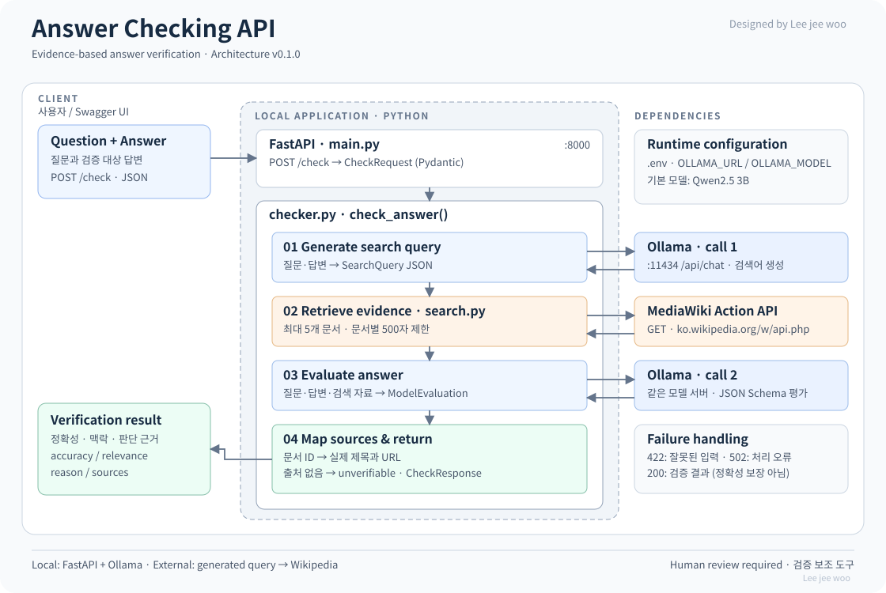
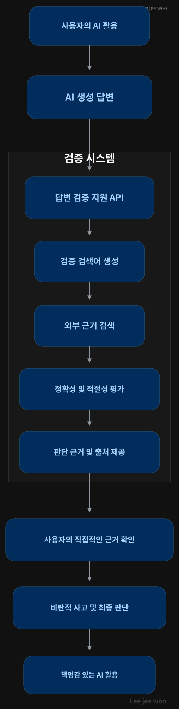

# Answer Checking API

[](README.md) [](README.en.md)


> An evidence-based API for evaluating the factual accuracy and contextual relevance of AI-generated answers to support AI literacy.

## Table of Contents

- [Answer Checking API](#answer-checking-api)
  - [Table of Contents](#table-of-contents)
  - [Overview](#overview)
  - [Project Status](#project-status)
  - [Features](#features)
  - [Architecture](#architecture)
    - [Verification Pipeline](#verification-pipeline)
    - [Technology Stack](#technology-stack)
  - [AI Literacy](#ai-literacy)
  - [Execution Example](#execution-example)
    - [01. User Input](#01-user-input)
    - [02. Search Query Generation](#02-search-query-generation)
    - [03. Evidence Retrieval](#03-evidence-retrieval)
    - [04. Evidence-based Evaluation](#04-evidence-based-evaluation)
    - [05. Model Output](#05-model-output)
    - [Result Analysis](#result-analysis)
  - [Improvement History](#improvement-history)
  - [API Reference](#api-reference)
    - [Evaluation Criteria](#evaluation-criteria)
  - [Getting Started](#getting-started)
    - [Requirements](#requirements)
    - [Installation](#installation)
    - [Configuration](#configuration)
    - [Run](#run)
  - [Project Structure](#project-structure)
  - [Limitations](#limitations)
  - [Roadmap](#roadmap)
  - [Originality](#originality)
  - [License](#license)

## Overview

https://github.com/user-attachments/assets/695e9b43-b6fb-42f2-a3fb-913bcb6b9bfb

Generative AI answers may contain factual errors or inappropriate information. Answer Checking API retrieves external information and uses a language model to assess the factual accuracy and contextual relevance of AI-generated answers.

By providing assessments alongside explanations and references, the project aims to support critical thinking and responsible AI use.

## Project Status

**Experimental Prototype · Proof of Concept (PoC)**

This is an early-stage project exploring the feasibility of evidence-based answer verification. It does not guarantee accurate assessments. Ongoing experimentation aims to improve reliability and scalability.

## Features

- Factual accuracy and contextual relevance assessment
- Verification using external information retrieval
- Explanations and reference sources
- An unverifiable outcome when evidence is insufficient
- REST API interface
- Local language model inference

## Architecture



The system uses FastAPI and runs a local language model through Ollama. It combines external information retrieval with model inference to evaluate answers against evidence.

### Verification Pipeline

1. Receive a question and the AI-generated answer to evaluate.
2. Generate a search query using the language model.
3. Retrieve external evidence through the Wikipedia API.
4. Evaluate the question, answer, and retrieved documents.
5. Map model-selected document IDs to actual references.
6. Return structured JSON results.

### Technology Stack

| Component | Technology |
|---|---|
| Language | Python |
| API Framework | FastAPI |
| ASGI Server | Uvicorn |
| Data Validation | Pydantic |
| Model Runtime | Ollama |
| Language Model | Qwen2.5 (default: 3B) |
| Information Retrieval | MediaWiki Action API |
| HTTP Client | Requests |

## AI Literacy



The project is not solely intended to automate judgments about whether an AI answer is true or false. It encourages users to inspect evidence and references, think critically, and make their own final judgments. The system supports rather than replaces human judgment.

## Execution Example

The following example is based on an actual execution log. System prompts and full document contents are omitted. The original Korean input and model output are preserved for reproducibility; the diagrams also retain their original Korean labels.

### 01. User Input

```json
{
  "question": "태양계에서 가장 큰 행성은?",
  "answer": "지구입니다."
}
```

English meaning: What is the largest planet in the Solar System? The answer to verify is “Earth.”

### 02. Search Query Generation

The first model call generates a search query for verification.

```json
{
  "query": "태양계에서 가장 큰 행성은?"
}
```

### 03. Evidence Retrieval

```text
[QUERY] 태양계에서 가장 큰 행성은?
[RESULTS] 5개
```

| ID | Document (translated title) |
|---|---|
| 1 | Exoplanet |
| 2 | Planet |
| 3 | Solar System |
| 4 | Jupiter |
| 5 | Formation and evolution of the Solar System |

Each retrieved document is limited to 500 characters before being passed to the model.

### 04. Evidence-based Evaluation

The second model call receives the original question, answer, and retrieved documents. The following simplified input illustrates the key evidence; the actual run included five documents.

```json
{
  "question": "태양계에서 가장 큰 행성은?",
  "answer": "지구입니다.",
  "documents": [
    {
      "id": 4,
      "title": "목성",
      "url": "https://ko.wikipedia.org/wiki/목성",
      "content": "목성은 태양계에서 가장 큰 행성이다."
    }
  ]
}
```

The key evidence identifies Jupiter as the largest planet in the Solar System.

### 05. Model Output

Actual model output:

```json
{
  "accuracy": "incorrect",
  "relevance": "relevant",
  "reason": "태양계에서 가장 큰 행성은 목성이며, 지구는 태양계의 중형 행성입니다.",
  "source_ids": [1, 2, 3, 4]
}
```

The model identifies Jupiter as the largest planet and describes Earth as a medium-sized planet. This latter description is part of the original model output, not an independently verified classification.

The selected document IDs are mapped to their actual titles and URLs to construct the final API response.

```text
POST /check HTTP/1.1 200 OK
```

### Result Analysis

The incorrect answer was successfully classified as `incorrect` in this run. However, not all selected sources directly support the assessment, and some wording in the explanation requires further review. HTTP 200 indicates successful request processing, not verified factual accuracy. A single successful run does not establish overall performance.

## Improvement History

Early tests produced incorrect classifications despite retrieving relevant external evidence. The evaluation prompt was revised, and the length of the documents passed to the model was reduced.

| Experiment | Change | Observed Classification |
|---|---|---|
| Initial test | Baseline verification pipeline | `unverifiable` |
| Prompt refinement | More explicit evaluation criteria and an example | `unverifiable` |
| Document length limit | Maximum 500 characters per document | `incorrect` |

These observations concern the same test question. A correct classification was observed after limiting document length, but controlled, repeated tests across diverse questions are needed to establish causality and overall performance improvements.

## API Reference

| Method | Endpoint | Description |
|---|---|---|
| POST | `/check` | Evaluate an AI-generated answer |
| GET | `/health` | Check API server status |
| GET | `/docs` | Swagger UI |

`POST /check` accepts two strings: `question` (1–4,000 characters) and `answer` (1–12,000 characters). It returns `accuracy`, `relevance`, `reason`, and `sources`. Sources contain actual document titles and URLs; the model's internal `source_ids` are not returned directly.

### Evaluation Criteria

**Factual Accuracy**

| Value | Description |
|---|---|
| `correct` | Consistent with the facts |
| `incorrect` | Inconsistent with the facts |
| `partially_correct` | Contains some factual errors |
| `unverifiable` | Insufficient evidence for verification |

**Contextual Relevance**

| Value | Description |
|---|---|
| `relevant` | Addresses the question |
| `partially_relevant` | Partially addresses the question |
| `irrelevant` | Does not address the question |

## Getting Started

### Requirements

- Python 3.10+
- Ollama
- Internet connection (for external retrieval and model downloads)

### Installation

Run the following commands in an authorized local copy of the project.

```bash
pip install -r requirements.txt
ollama pull qwen2.5:3b
```

### Configuration

Create a `.env` file using `.env.example` as a reference.

```dotenv
OLLAMA_URL=http://localhost:11434
OLLAMA_MODEL=qwen2.5:3b
```

### Run

Start Ollama if its server is not already running.

```bash
ollama serve
```

In a separate terminal, start FastAPI.

```bash
uvicorn main:app --reload
```

API testing and documentation: <http://127.0.0.1:8000/docs>

## Project Structure

| File | Description |
|---|---|
| `main.py` | API endpoints and error handling |
| `checker.py` | Verification pipeline and model calls |
| `search.py` | External information retrieval |
| `schemas.py` | Request and response schemas |
| `requirements.txt` | Python dependencies |
| `.env.example` | Example environment configuration |
| `assets/` | Architecture and visualization assets |

## Limitations

- External information retrieval is currently limited to Korean Wikipedia.
- Assessment quality depends on the retrieved evidence and language model.
- Explanations and source selection may be inaccurate.
- Document truncation may omit important evidence.
- Debug logs contain input data; avoid entering sensitive information.
- Overall verification accuracy and educational outcomes for students have not yet been established.

## Roadmap

- Expand external information sources.
- Improve verification models and evaluation methods.
- Assess the reliability of evidence and references.
- Introduce claim-level fact verification.
- Quantitatively evaluate verification performance.
- Improve system stability and scalability.

## Originality

This project was designed and implemented using existing technologies, publicly available development tools, and generative AI assistance. Related research and technologies already exist. The project does not claim exclusive rights to general verification methods or technological firstness.

A comprehensive prior-art investigation and third-party copyright similarity review have not yet been completed.

## License

No open-source license has been granted.

Rights in copyright-protected portions remain with their respective rights holders. Third-party libraries, AI models, and data remain subject to their own licenses and terms.

---

**Answer Checking API** · Developed by Lee jee woo · 2026
