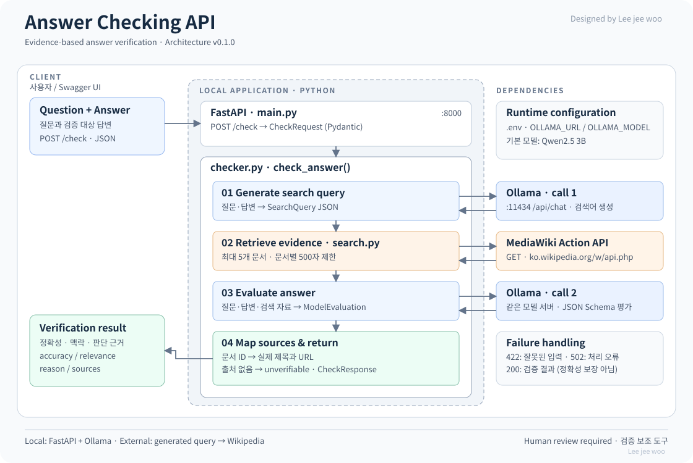
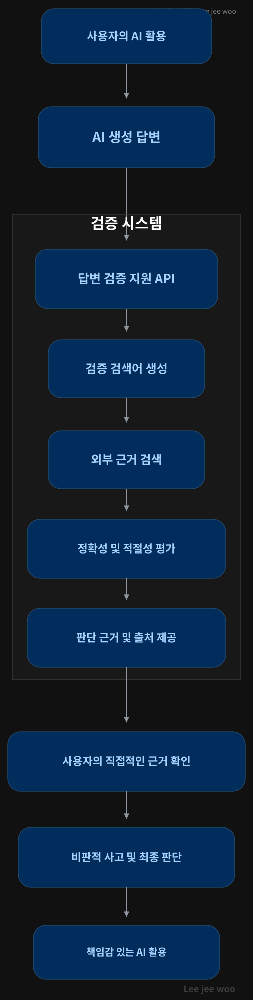

# Answer Checking API

[](README.md) [](README.en.md)


> AI 리터러시 향상을 위해 생성형 AI 답변의 사실 정확성과 맥락적 적절성을 평가하는 검증 API

## 목차

- [프로젝트 소개](#overview)
- [개발 상태](#project-status)
- [주요 기능](#features)
- [시스템 아키텍처](#architecture)
- [AI 리터러시](#ai-literacy)
- [실제 실행 사례](#execution-example)
- [개선 기록](#improvement-history)
- [API 명세](#api-reference)
- [설치 및 실행](#getting-started)
- [파일 구조](#project-structure)
- [한계](#limitations)
- [향후 개발 계획](#roadmap)
- [독창성](#originality)
- [라이선스](#license)

## Overview

https://github.com/user-attachments/assets/695e9b43-b6fb-42f2-a3fb-913bcb6b9bfb

생성형 AI의 답변에는 사실 오류나 부적절한 정보가 포함될 수 있습니다. Answer Checking API는 외부 정보를 검색하고 언어 모델을 활용하여 AI 답변의 사실 정확성과 맥락적 적절성을 평가하는 프로젝트입니다.

평가 결과와 함께 판단 근거 및 참고 출처를 제공하여 사용자의 비판적 사고와 책임감 있는 AI 활용을 지원하는 것을 목표로 합니다.

## Project Status

**Experimental Prototype · Proof of Concept (PoC)**

현재 핵심 검증 기능의 기술적 가능성을 탐구하는 초기 개발 단계입니다. 검증 결과의 정확성을 보장하지 않으며, 지속적인 실험과 개선을 통해 신뢰성과 확장성을 높이고자 합니다.

## Features

- AI 답변의 사실 정확성 및 맥락적 적절성 평가
- 외부 정보 검색 기반 검증
- 판단 근거 및 참고 출처 제공
- 근거 부족 시 판단 보류
- REST API 기반의 검증 인터페이스
- 로컬 언어 모델을 활용한 추론

## Architecture



FastAPI를 기반으로 구현하고 Ollama를 통해 로컬 언어 모델을 실행합니다. 외부 정보 검색과 언어 모델의 추론을 결합하여 근거 기반 검증을 수행합니다.

### Verification Pipeline

1. 질문과 검증 대상 AI 답변 입력
2. 언어 모델을 통한 검색어 생성
3. Wikipedia API를 통한 외부 근거 수집
4. 질문, 답변 및 검색 자료를 기반으로 평가
5. 모델이 선택한 문서 ID와 실제 출처 연결
6. 구조화된 JSON 형식으로 검증 결과 반환

### Technology Stack

| Component | Technology |
|---|---|
| Language | Python |
| API Framework | FastAPI |
| ASGI Server | Uvicorn |
| Data Validation | Pydantic |
| Model Runtime | Ollama |
| Language Model | Qwen2.5 (기본: 3B) |
| Information Retrieval | MediaWiki Action API |
| HTTP Client | Requests |

## AI Literacy



본 프로젝트는 AI 답변의 진위를 자동으로 판단하는 것에만 목적을 두지 않습니다. 사용자가 제공된 근거와 출처를 직접 확인하고 비판적으로 사고하여 최종 판단을 내리도록 지원합니다. 검증 시스템은 인간의 판단을 대체하는 것이 아니라 보조하는 역할을 수행합니다.

## Execution Example

실제 실행 로그에서 핵심 데이터를 발췌했습니다. 시스템 프롬프트와 문서 전문은 생략했습니다.

### 01. User Input

```json
{
  "question": "태양계에서 가장 큰 행성은?",
  "answer": "지구입니다."
}
```

### 02. Search Query Generation

첫 번째 모델 호출에서 검증용 검색어를 생성합니다.

```json
{
  "query": "태양계에서 가장 큰 행성은?"
}
```

### 03. Evidence Retrieval

```text
[QUERY] 태양계에서 가장 큰 행성은?
[RESULTS] 5개
```

| ID | Document |
|---|---|
| 1 | 외계 행성 |
| 2 | 행성 |
| 3 | 태양계 |
| 4 | 목성 |
| 5 | 태양계의 형성과 진화 |

수집한 문서는 각각 최대 500자로 제한하여 모델에 전달합니다.

### 04. Evidence-based Evaluation

두 번째 모델 호출에는 최초 질문, 답변, 검색 자료가 함께 입력됩니다. 다음은 핵심 근거만 남긴 요약 예시입니다. 실제 실행에서는 문서 5개를 전달했습니다.

```json
{
  "question": "태양계에서 가장 큰 행성은?",
  "answer": "지구입니다.",
  "documents": [
    {
      "id": 4,
      "title": "목성",
      "url": "https://ko.wikipedia.org/wiki/목성",
      "content": "목성은 태양계에서 가장 큰 행성이다."
    }
  ]
}
```

### 05. Model Output

실제 모델 출력:

```json
{
  "accuracy": "incorrect",
  "relevance": "relevant",
  "reason": "태양계에서 가장 큰 행성은 목성이며, 지구는 태양계의 중형 행성입니다.",
  "source_ids": [1, 2, 3, 4]
}
```

선택된 문서 ID를 실제 문서 제목 및 URL과 연결하여 최종 API 응답을 구성합니다.

```text
POST /check HTTP/1.1 200 OK
```

### Result Analysis

이번 실행에서는 잘못된 답변을 `incorrect`로 분류하는 데 성공했습니다. 다만 선택한 출처가 모두 직접적인 검증 근거에 해당하지는 않으며, 판단 근거의 일부 표현도 추가 검토가 필요합니다. HTTP 200은 요청 처리 성공을 의미하며, 단일 실행 사례가 전체 검증 정확도를 보장하지는 않습니다.

## Improvement History

초기 테스트에서는 정확한 외부 근거를 확보했음에도 모델이 답변을 올바르게 분류하지 못했습니다. 평가 프롬프트를 수정하고 모델에 전달하는 문서 길이를 제한하여 개선을 시도했습니다.

| 실험 단계 | 변경 사항 | 관찰된 평가 결과 |
|---|---|---|
| 초기 테스트 | 기본 검증 파이프라인 | `unverifiable` |
| 프롬프트 개선 | 평가 기준 구체화 및 예시 추가 | `unverifiable` |
| 문서 길이 제한 | 문서별 최대 500자 적용 | `incorrect` |

동일한 질문을 대상으로 한 실행 기록입니다. 문서 길이 제한 후 올바른 분류가 관찰되었지만, 인과관계와 전체 성능 향상을 확인하려면 더 다양한 사례를 대상으로 통제된 반복 실험이 필요합니다.

## API Reference

| Method | Endpoint | Description |
|---|---|---|
| POST | `/check` | AI 답변 검증 요청 |
| GET | `/health` | API 서버 상태 확인 |
| GET | `/docs` | Swagger UI |

`POST /check`는 문자열 `question`(1~4,000자)과 `answer`(1~12,000자)를 받으며, `accuracy`, `relevance`, `reason`, `sources`를 반환합니다. `sources`에는 실제 문서 제목과 URL이 포함됩니다. 모델 내부의 `source_ids`는 최종 응답에 그대로 노출되지 않습니다.

### Evaluation Criteria

**Factual Accuracy**

| Value | Description |
|---|---|
| `correct` | 사실과 일치함 |
| `incorrect` | 사실과 일치하지 않음 |
| `partially_correct` | 일부 내용에 오류가 있음 |
| `unverifiable` | 충분한 검증 근거가 없음 |

**Contextual Relevance**

| Value | Description |
|---|---|
| `relevant` | 질문의 의도에 부합함 |
| `partially_relevant` | 질문의 의도에 일부 부합함 |
| `irrelevant` | 질문의 의도에 부합하지 않음 |

## Getting Started

### Requirements

- Python 3.10+
- Ollama
- 인터넷 연결 (외부 검색 및 모델 다운로드)

### Installation

권한이 있는 로컬 프로젝트 폴더에서 다음 명령을 실행합니다.

```bash
pip install -r requirements.txt
ollama pull qwen2.5:3b
```

### Configuration

`.env.example`을 참고하여 `.env` 파일을 생성합니다.

```dotenv
OLLAMA_URL=http://localhost:11434
OLLAMA_MODEL=qwen2.5:3b
```

### Run

Ollama 서버가 실행 중이지 않다면 실행합니다.

```bash
ollama serve
```

별도의 터미널에서 FastAPI를 실행합니다.

```bash
uvicorn main:app --reload
```

API 테스트 및 문서: <http://127.0.0.1:8000/docs>

## Project Structure

| File | Description |
|---|---|
| `main.py` | API 엔드포인트 및 오류 처리 |
| `checker.py` | 검증 파이프라인 및 모델 호출 |
| `search.py` | 외부 정보 검색 및 수집 |
| `schemas.py` | 입출력 데이터 형식 정의 |
| `requirements.txt` | Python 의존성 관리 |
| `.env.example` | 환경 설정 예시 |
| `assets/` | 아키텍처 및 시각화 자료 |

## Limitations

- 외부 정보 검색 범위가 한국어 Wikipedia로 제한됩니다.
- 검색 자료와 모델의 품질에 따라 결과가 달라질 수 있습니다.
- 판단 근거 및 출처 선택이 부정확할 수 있습니다.
- 문서 길이 제한으로 중요한 근거가 누락될 수 있습니다.
- 디버깅 로그에 입력 데이터가 기록되므로 민감한 정보 입력에 주의해야 합니다.
- 학생 대상 사용 효과 및 전체 검증 정확도는 아직 입증되지 않았습니다.

## Roadmap

- 외부 정보 검색 범위 확대
- 검증 모델 및 평가 방식 개선
- 판단 근거와 출처의 신뢰성 평가
- 개별 주장 단위의 사실 검증
- 검증 성능의 정량적 측정
- 시스템의 안정성 및 확장성 개선

## Originality

본 프로젝트는 기존 기술, 공개된 개발 도구 및 생성형 AI의 지원을 활용하여 설계하고 구현되었습니다. 관련 선행 연구와 기술이 존재하며, 일반적인 검증 방법론 자체에 대한 독점적 권리나 기술적 최초성을 주장하지 않습니다.

포괄적인 선행 기술 조사 및 제3자 저작물과의 유사성 검토는 아직 완료되지 않았습니다.

## License

No open-source license has been granted.

본 프로젝트에는 별도의 오픈소스 라이선스가 부여되어 있지 않습니다. 저작권으로 보호되는 부분에 대한 권리는 해당 권리자에게 귀속됩니다. 외부 라이브러리, AI 모델 및 데이터에는 각각의 라이선스와 이용 조건이 적용됩니다.

---

**Answer Checking API** · Developed by Lee jee woo · 2026
